# Doodlemark

[](https://github.com/owaistaha/doodlemark/actions/workflows/ci.yml)

**An iPad app that turns a finger doodle into a real vector logo: sketch, ink it clean, add a name and colors, export SVG + transparent PNG. Fully offline, built for kids.**

<!-- Demo GIF goes here (recorded on a real iPad) -->
> **Demo:** _GIF coming soon_ (`docs/demo.gif`)

| Gallery | Canvas | Preview & export |
|---|---|---|
| 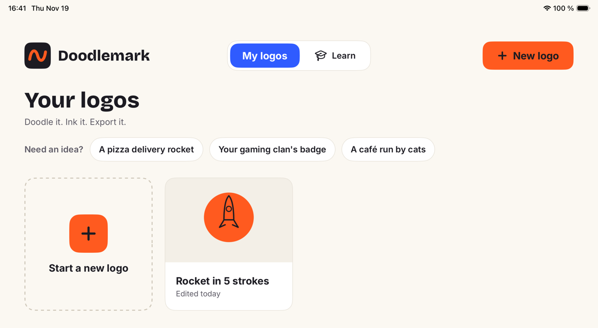 | 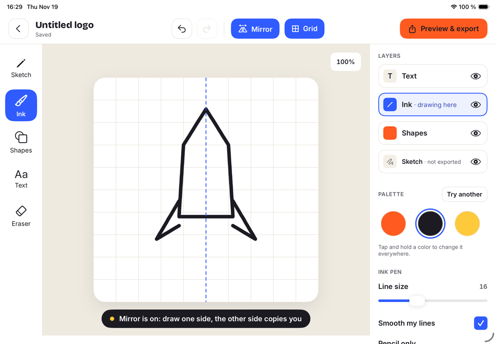 | 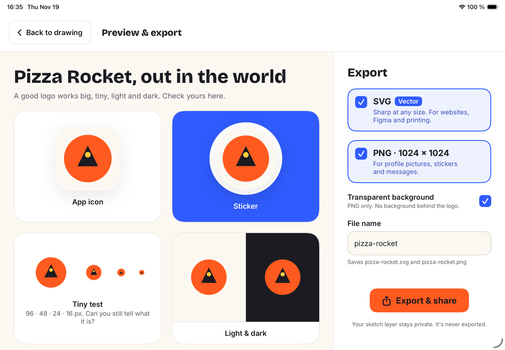 |

## The problem

Procreate is the drawing app most iPad kids already know, and it only exports
pixels: `.procreate`, PSD, PDF, JPEG, PNG, TIFF, GIF, MP4. There is no SVG. A
logo drawn there can't be scaled up for a banner or opened in Figma without
being redrawn in a pro vector tool, which isn't built for sketching and scares
off a 10-year-old.

Doodlemark keeps the "sketch freely" feel of a drawing app, but everything you
ink is stored so it can be exported as clean vectors that look the same as the
canvas.

## Features

- **Four fixed layers:** a faded **Sketch** layer for messy ideas (never
  exported), constant-width **Ink** lines on top, filled **Shapes** (circle,
  rounded square, triangle, star), and **Text** in a logo font.
- **Finger first:** one finger draws and two fingers pan/zoom. Any stylus and
  Apple Pencil work too, and nothing needs pressure, tilt or hover.
- **"Smooth my lines"** cleans shaky finger strokes and keeps corners and ends
  pinned. **Mirror** copies one side to the other.
- **3-color palettes:** 12 curated sets, a long press to pick your own, and ink
  lines that follow their palette slot when you switch.
- **Your name** in 5 bundled open-license logo fonts, exported as outlines.
- **Undo/redo** across all four layers (buttons, two/three-finger taps, ⌘Z).
- **Preview** on an app-icon tile, a round sticker and a tiny size in light and
  dark, then **export SVG + transparent PNG** with the share sheet.
- **Learn mode:** 5 short lessons (Rocket in 5 strokes, Lightning shield,
  Star club badge, Cat face badge, Moon café). You trace dashed guides stroke by stroke and get 0–3 stars
  with a kind, specific tip. "Make it yours" turns the result into your own logo.
- **Autosave** (1 s after you stop, atomic writes), a gallery with rename,
  duplicate and delete, and prompt cards for when you don't know what to draw.

### Every screen

| | |
|---|---|
|  **My logos** (gallery) | 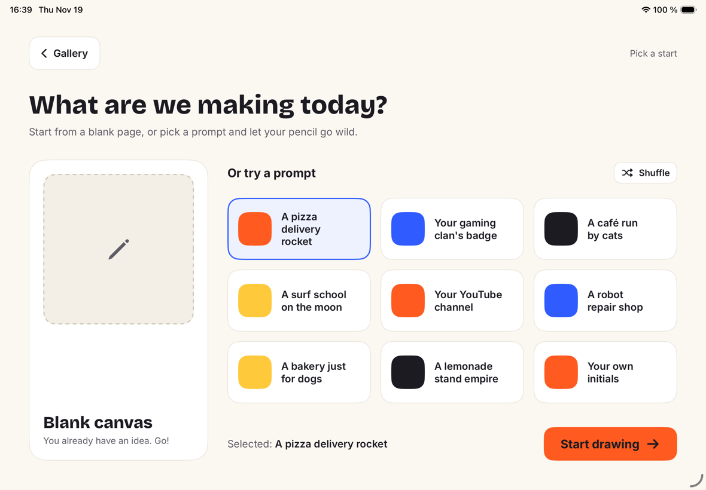 **New logo** (blank or a prompt card) |
|  **Canvas** (Sketch, Ink, Mirror, grid) | 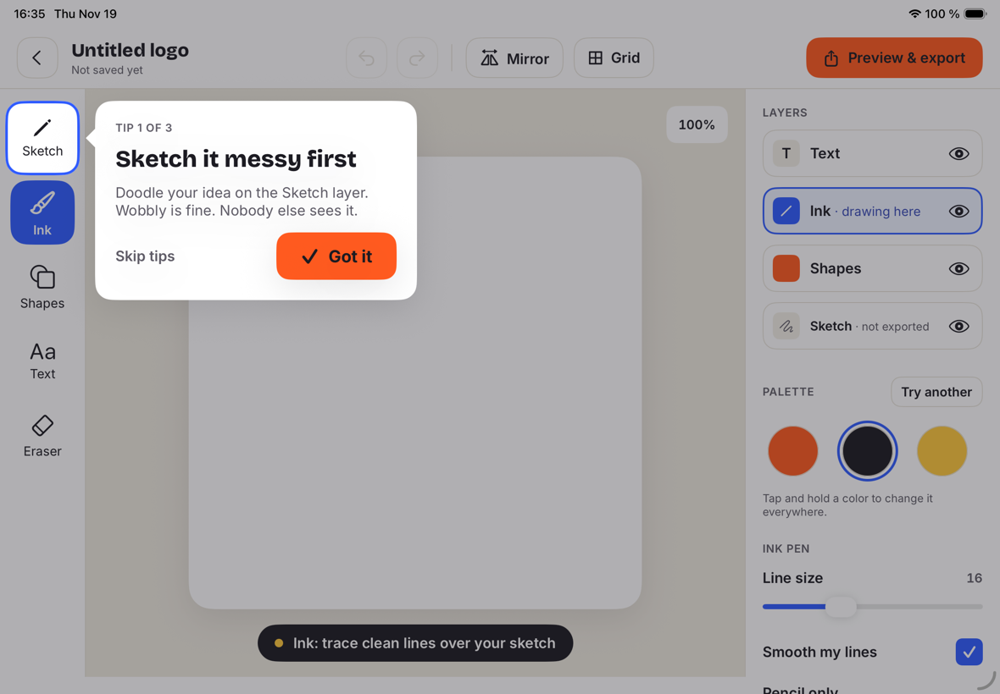 **First-canvas tips** (3, shown once) |
| 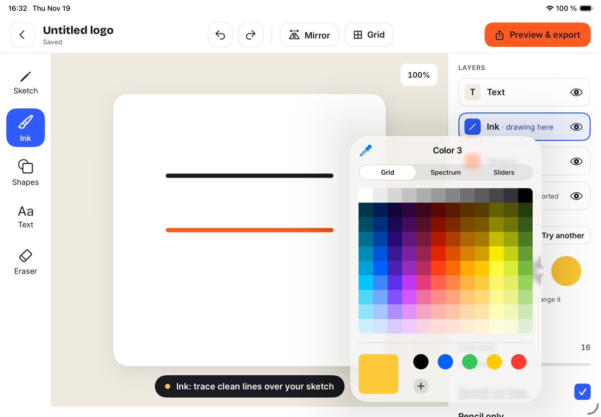 **Palettes** | 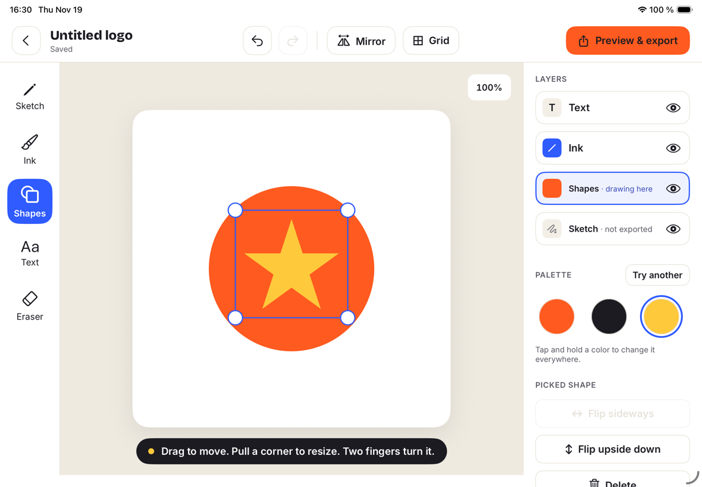 **Shapes** |
| 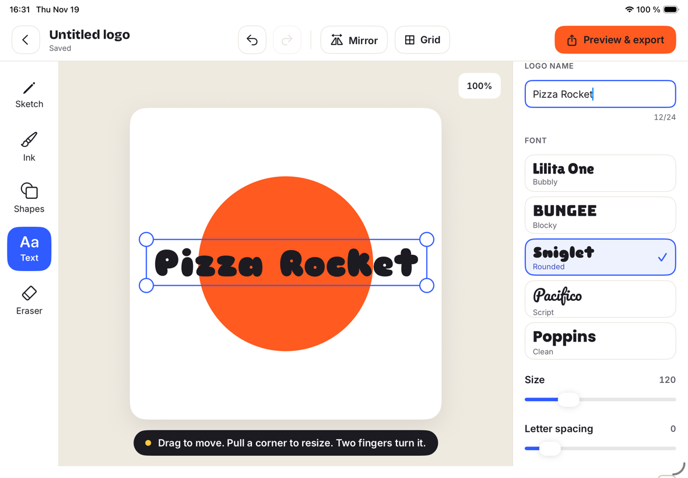 **Text** (logo fonts) |  **Preview & export** |
| 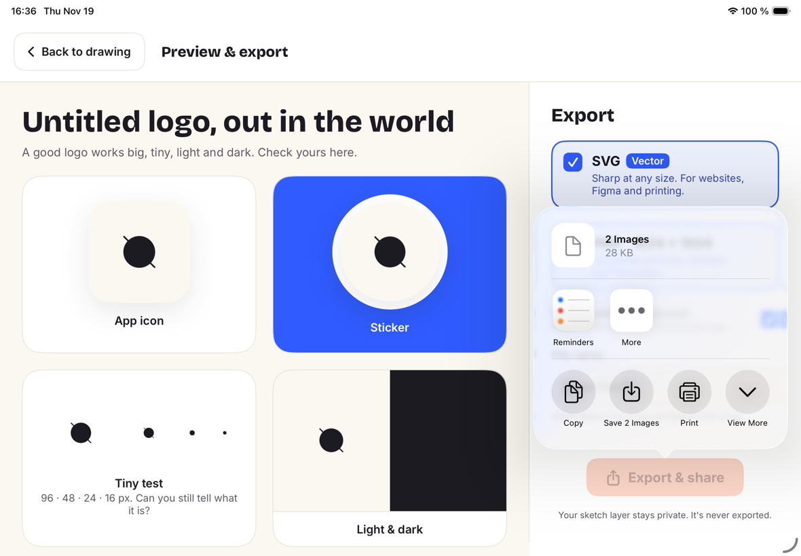 **Share** (SVG + PNG) | 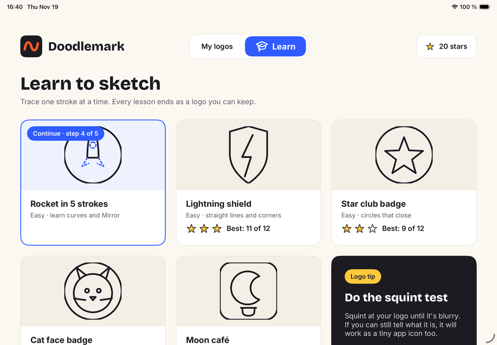 **Learn** |
| 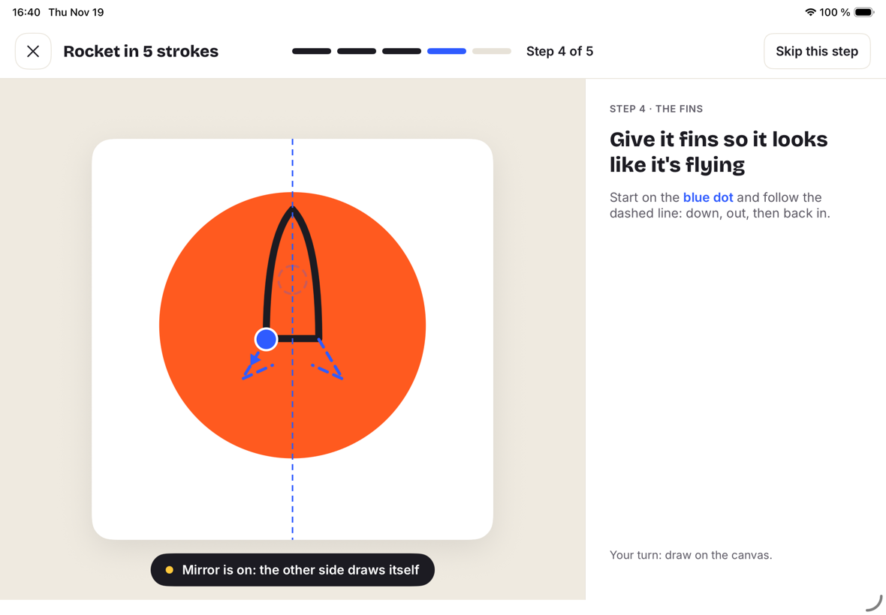 **Lesson player** | 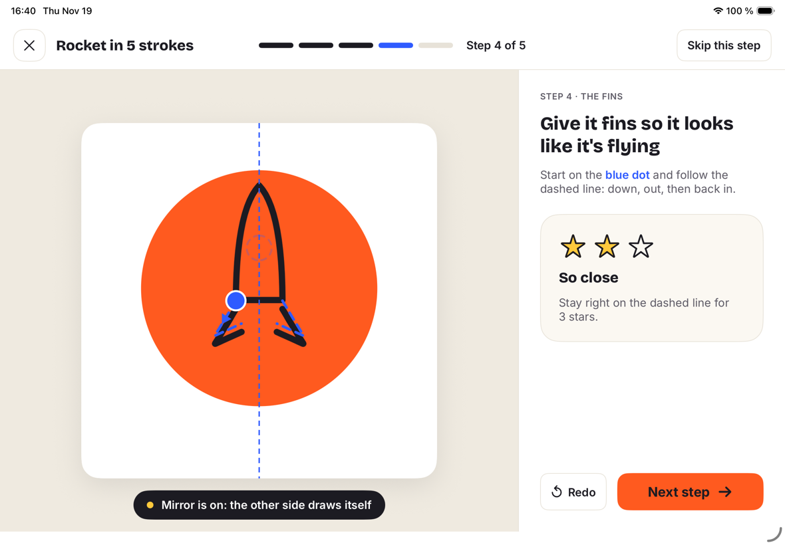 **Stroke result** |
| 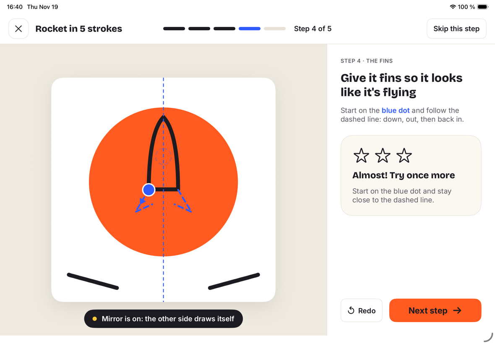 **0 stars, said kindly** | 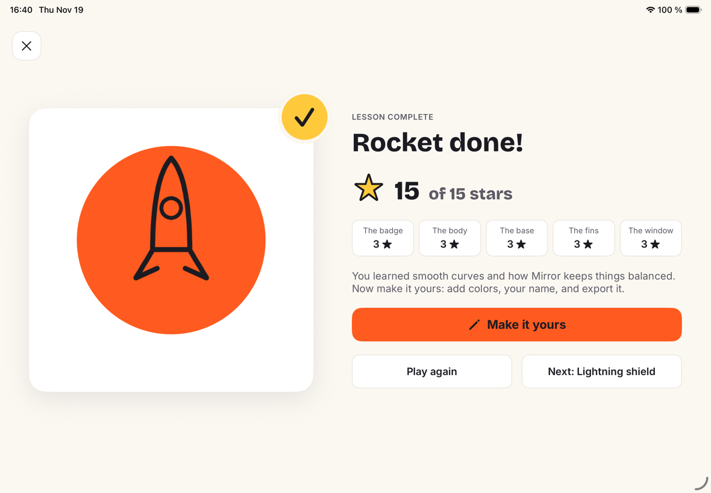 **Lesson complete** |

All screenshots are from the iPad (A16) simulator, taken by the UI tests.

## Architecture

Native SwiftUI + PencilKit, iPadOS 17+, no third-party packages, no network
code. The Xcode project is generated from `project.yml` by XcodeGen.

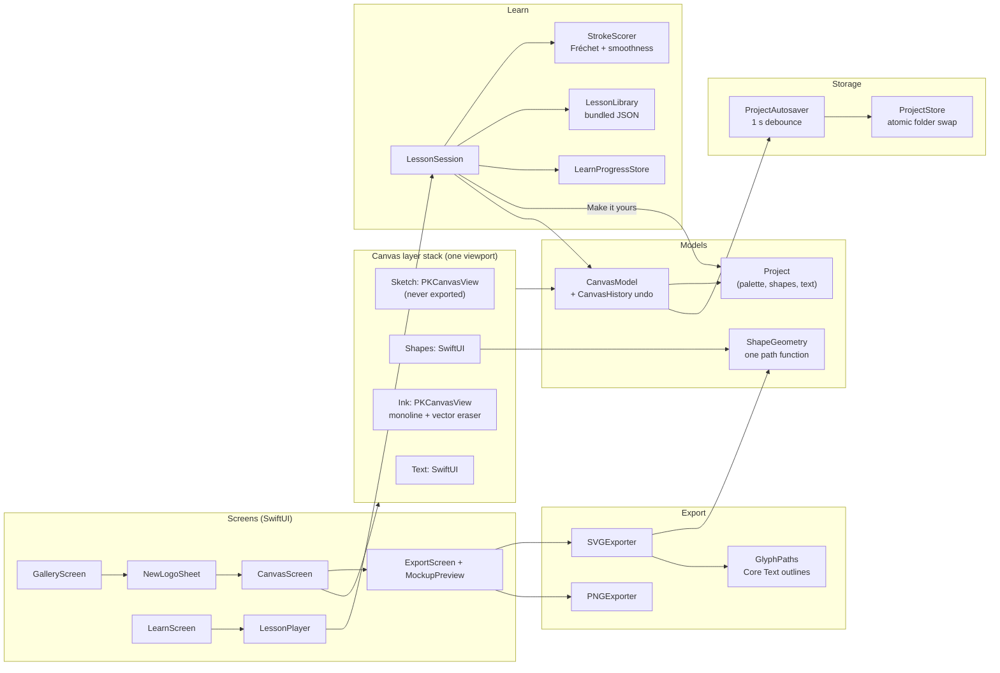

| Folder | What's in it |
|---|---|
| `Doodlemark/App` | App entry and navigation (`AppModel`), `Theme` tokens from DESIGN.md, shared buttons |
| `Doodlemark/Models` | `Project`, shapes, text, the 12 palettes, prompt cards, the 5 logo fonts |
| `Doodlemark/Canvas` | The editor: layer stack, viewport, tools, undo history, smoothing, mirror, shape editing |
| `Doodlemark/Export` | `SVGExporter`, `GlyphPaths`, `PNGExporter`, export files |
| `Doodlemark/Learn` | Lessons, `StrokeScorer`, progress, lesson player and complete screens |
| `Doodlemark/Storage` | `ProjectStore` (versioned files, atomic saves), autosave, thumbnails |
| `Doodlemark/Screens` | Gallery, New logo, palette picker, Preview & export, mockups |
| `Doodlemark/Debug` | DEBUG builds only: export check screen, launch flags for tests |
| `DoodlemarkTests` | Unit tests, including the SVG export gate (`Gate/`) |
| `DoodlemarkUITests` | UI tests with real synthesized touches |
| `scripts` | `make_app_icon.swift` (draws every app icon size), the CI simulator picker |

## How the SVG export works

PencilKit can only export bitmaps, so the exporter is hand-built. Three design
decisions make a faithful export possible:

- the Ink layer uses **monoline ink only** (constant width), so every line is
  one SVG stroke;
- the Ink layer uses **the vector eraser only**, so strokes are always whole
  (no pixel masks);
- the Sketch layer is never exported.

**The stroke → SVG pipeline** (`Export/SVGExporter.swift`):

1. **Sample.** Each Ink stroke is sampled every 2 pt along PencilKit's spline,
   with the stroke's `transform` applied. Skipping the transform works until
   someone moves a stroke with the lasso, and then the export is shifted.
2. **Simplify** with Ramer–Douglas–Peucker at 0.25 pt. At 0.5 pt, finger wobble
   visibly flattened in the gate.
3. **Merge corner curls.** At a sharp corner PencilKit's spline makes a tiny
   curl, and RDP keeps 3–5 points in it about 2 pt apart. Inside those runs the
   points are simplified again at 0.75 pt. The run's two end points, where the
   long lines attach, never move. A first version merged each curl into one
   corner point, but that tilted the whole attached line, and the gate's worst
   tile went from 1% to 23%. So it was replaced.
4. **Fit curves.** Catmull-Rom cubics, with handles a third of the shorter
   neighbouring chord. Turns over 45° keep one-sided tangents, so a "V" stays a
   V instead of becoming a U.
5. **Width.** PencilKit does **not** draw a monoline stroke at its stored
   width. Measured on the simulator: **rendered = 2w − 4** (w = stored point
   width; 4 → 4, 8 → 12, 16 → 28). The pen stores tool width + 2, so a line is
   exactly 2 × tool width thick, and the exported `stroke-width` equals the
   Line size the kid picked. `MonolineWidthTests` re-measures this law against
   the real renderer, so a future iOS change fails loudly.
6. **Shapes and text.** Shapes come from the **same geometry function** the
   canvas draws with, so the two can't drift apart. Text is exported as
   **glyph outlines** from Core Text, never `<text>`, so the file looks right
   on machines without the font. A fallback glyph from a system font is
   refused, because the system fonts' license doesn't allow logo use.

Cleaning up the corner curls shrank the step 7 export (`pizza-rocket.svg`) from
7,318 to 7,060 bytes. Its tiny (<3 pt) segments went from 14 to 2, and its runs
of tiny segments from 5 to 0. The wobbliest gate fixture went from 25,959 to
24,626 bytes.

### The pixel-diff gate

`DoodlemarkTests/SVGExportTests.swift` is the project's hard gate: it had to
pass before any real UI was built, and it runs on every push. For 17 fixtures
(lines, curves, a zig-zag, finger wobble, a transformed stroke, single-tap
dots, shapes, each logo font, rotated text, a full logo):

- it builds the drawing in code;
- it renders it natively (`PKDrawing.image` + shapes + text drawn with
  `CTLineDraw`, independently of the exporter);
- it exports the SVG and renders that in `WKWebView`;
- it compares the two at 1024 × 1024.

A fixture passes only if all three checks pass:

| Check | Threshold |
|---|---|
| Pixels that differ | < 2% |
| IoU of painted pixels | ≥ 0.90 |
| Worst 32 × 32 tile: mismatching painted pixels | ≤ 25% |

**Why the 2% rule alone wasn't enough:** a whole logo has so many pixels that
one small mistake vanishes into the average. The gate proves this with three
**negative controls**: the same logo exported with one stroke shifted 4 pt,
one stroke dropped, or one stroke in the wrong color. All three must **fail**,
and only the tile check catches them:

| Negative control | Pixels differ (limit 2%) | IoU (limit 0.90) | Worst tile (limit 25%) |
|---|---|---|---|
| One stroke shifted 4 pt | 0.34% (passes) | 0.985 (passes) | **69%: fails** |
| One stroke dropped | 0.50% (passes) | 0.979 (passes) | **100%: fails** |
| One stroke in the wrong color | 0.50% (passes) | 0.998 (passes) | **100%: fails** |

Real fixtures stay far from the limits: the worst real tile is 5.6% (finger
wobble), and most are under 1%. Thresholds are never loosened to make a test
pass.

## How Learn mode scores a stroke

Scoring is deterministic geometry (`Learn/StrokeScorer.swift`): no ML, no
network, and the same stroke always gets the same score. It always scores the
**raw** stroke, before "Smooth my lines".

1. **Resample** the stroke and the dashed target to 64 evenly spaced points, in
   the 1024 canvas space. Zoom never changes the score.
2. **Shape:** the **discrete Fréchet distance** between the two. Fréchet is the
   "dog on a leash" distance: it respects drawing order, so a scribble that
   covers the right area in the wrong order doesn't score well. Going the
   other way round is allowed. ≤ 18 pt → 3★, ≤ 36 → 2★, ≤ 60 → 1★, else
   "Almost! Try once more" (never "failed").
3. **Smoothness:** the mean turning angle along the stroke, **minus the
   target's own** (so the lightning bolt's corners aren't counted as wobble).
   Too wobbly costs one star, and never takes a stroke below 1★ on its own.
4. **Length:** too short says "draw the whole line". "Stop at the end" is
   only said if the stroke really traced the line and kept going. Otherwise
   the tip names the real problem.
5. **Tip:** fixed, kid-friendly copy for the main problem (shape, direction,
   length or wobble). Nothing is generated.

**Fairness calibration.** Before a real iPad was available, a test traces every
step of every lesson with simulated fingers. These are the gate's wobble at
several strengths plus a slow drift off the line, drawn as real PencilKit
strokes with 5 seeds each. It writes the spread to
`GateOutput/learn-calibration.txt` and asserts the rules in the last column:

| Simulated finger | Mean | 3★ | 0★ (redo) | Asserted |
|---|---|---|---|---|
| Steady (shake 0.5, drift 4 pt) | 3.00★ | 100% | 0% | always 3★ |
| Gate wobble (shake 1.0) | 2.30★ | 30% | 0% | |
| Typical (shake 1.0, drift 10 pt) | 2.31★ | 31% | 0% | mostly 2–3★, never a redo |
| Shaky (shake 2.0, drift 14 pt) | 2.10★ | 10% | 0% | |
| Sloppy (shake 3.0, drift 30 pt) | 0.98★ | 0% | 11% | never 3★; redos say "wobbly" (12 of 12), not "too long" |
| Way off (drift 70 pt) | 0.00★ | 0% | 100% | always a redo; tips say "stay close to the line" |

The thresholds live in `ScoringConfig.swift`. They still need checking with
real fingers on a real iPad (see the device checklist).

## Decisions & trade-offs

- **Native SwiftUI + PencilKit, not Flutter.** Pencil latency, palm rejection
  and PencilKit's stroke data model *are* the product. Flutter has no
  first-class PencilKit equivalent, and the exporter needs the real stroke data.
- **Monoline ink only.** Constant-width strokes export as one SVG stroke each,
  close to exact. Pressure ink would need outline polygons, so it's in v1.1.
  Side effect: a finger, a cheap stylus and an Apple Pencil all give identical
  results.
- **Four fixed layers instead of Procreate-style layers.** Sketch / Shapes /
  Ink / Text is all a logo needs. Each layer has one export rule, and kids
  never lose a drawing on a hidden layer.
- **Own undo stack.** PencilKit's undo couldn't undo a mirror copy added in
  code (found in the step 4a spike). One snapshot history now covers all four
  layers (100 steps), so a stroke + smoothing + mirror copy is one undo step.
- **Offline, no AI, no accounts.** The users are kids. There's no network
  code at all: no analytics, no crash reporter, no remote fonts. Learn
  feedback is deterministic geometry, not a model. The privacy label is
  "Data Not Collected", and it costs nothing to run.
- **Open-license fonts only.** Logo text uses 5 bundled OFL fonts, never SF Pro
  or system fonts, because Apple's font license doesn't allow them in logos.

## Testing

- **258 tests:**
  - 230 unit tests;
  - 28 UI tests with real synthesized touches (drawing, pinch-zoom, undo
    gestures, typing, the whole rocket lesson traced along its curves).

  The full suite passed three times in a row before this release: 257 passed
  and 1 skipped each time. The skip is the ⌘Z test, which only runs when a
  hardware keyboard is attached (`RISKS.md` #3).
- **What the gate proves:** for every fixture, the exported SVG renders the same
  as the canvas within the thresholds above. It also proves the gate itself can
  fail: the shifted, dropped and wrong-color controls must fail. Byte-exact
  snapshot SVGs catch any unintended change to the output.
- Other notable tests:
  - `ProjectStoreTests` simulates a crash at every point of a save and checks
    you get the full old save or the full new one, never a mix;
  - `MonolineWidthTests` re-measures PencilKit's width law;
  - `LessonLoaderTests` checks every lesson self-scores 3★ and runs the
    fairness calibration.
- **CI** ([`.github/workflows/ci.yml`](.github/workflows/ci.yml)):
  - on every push: build, unit tests and gate on the `macos-26` runner (Xcode
    26.6, iPad simulator on iOS 26.5), plus a Release build that's checked for
    leftover debug code;
  - UI tests run on manual trigger only: they're slow, and they use XCTest's
    private touch-synthesis API (`RISKS.md` #13).
- **What a simulator can't prove** is in
  [`DEVICE_CHECKLIST.md`](DEVICE_CHECKLIST.md): 76 numbered hand checks for a
  real iPad (Pencil, palm, AirDrop, VoiceOver, opening the SVG in Safari), each
  with the expected result.

## How this was built

I built Doodlemark with **Claude Code as my AI pair programmer**. I owned the
product: the PRD, the design (`design/*.png`, `DESIGN.md`), the specs
(`TECH_SPEC.md`, `CLAUDE.md` with its hard rules), the step-by-step build plan
with a stop for review after every step, and every decision along the way.
Claude Code wrote most of the Swift and the tests to those specs, then ran
builds, tests and simulator screenshots, and reported back.

Some calls this split produced:

- **The export gate came first.** "Can PencilKit drawings become faithful
  SVGs?" was the riskiest assumption, so a pixel-diff test had to pass before
  any UI was built.
- **The gate had to show it could fail.** When the 2% rule let a shifted
  stroke through, the fix was a stricter check (the tile test), not looser
  numbers.
- **Measure, don't assume.** The 2w − 4 width law, the portrait-space touch
  coordinates and the runner's Xcode version were all measured, not guessed.
- **Spikes before features.** The step 4a spike found that PencilKit's undo
  couldn't handle mirror copies, which led to the custom undo stack.
- **Root causes, not retries.** A flaky typing test turned out to be a real
  race that could drop a fast keystroke. It was fixed in the app, not with a
  retry.

## Run it

Requirements: Xcode 26+ and [XcodeGen](https://github.com/yonaskolb/XcodeGen)
(`brew install xcodegen`).

```sh
xcodegen generate                 # creates Doodlemark.xcodeproj from project.yml
open Doodlemark.xcodeproj         # run the Doodlemark scheme on an iPad simulator

# or from the command line:
xcodebuild test -project Doodlemark.xcodeproj -scheme Doodlemark \
  -destination "platform=iOS Simulator,id=$(scripts/pick_ipad_simulator.sh)" \
  -only-testing:DoodlemarkTests
```

To run on a real iPad, copy `Local.xcconfig.example` to `Local.xcconfig` and
set your Team ID (Xcode → Settings → Accounts; a free personal team works).
That file is gitignored, and simulator builds don't need it. The `.xcodeproj`
is generated: change `project.yml`, not the project. The app icon is drawn by
`swift scripts/make_app_icon.swift` (every iPad size + the 1024 App Store icon).

## Roadmap (v1.1)

- **Time-lapse replay** of how the logo was drawn (strokes already carry
  timestamps), recorded to MP4.
- **Hold-to-snap shapes:** pause at the end of a stroke to turn it into a clean
  line, circle or rectangle.
- **Pressure ink in SVG**, exported as filled outlines.
- **Brand kit PDF:** color / mono / inverted logo, palette hex codes, font name.
- **Pro unlock** (StoreKit 2, one-time), with a parental gate if listed in the
  Kids category.
- Calibrate the Learn thresholds with real kids' fingers on real iPads.

## Licenses

- **Code:** [MIT](LICENSE).
- **Fonts:** bundled unmodified under the
  [SIL Open Font License 1.1](https://openfontlicense.org). Each font's license
  sits next to it in `Doodlemark/Resources/Fonts/`:
  - UI: **Inter** (Regular, SemiBold, Bold) and **Bricolage Grotesque**
    (ExtraBold).
  - Logo: **Lilita One**, **Bungee**, **Sniglet** (ExtraBold), **Pacifico**
    and **Poppins** (ExtraBold).
